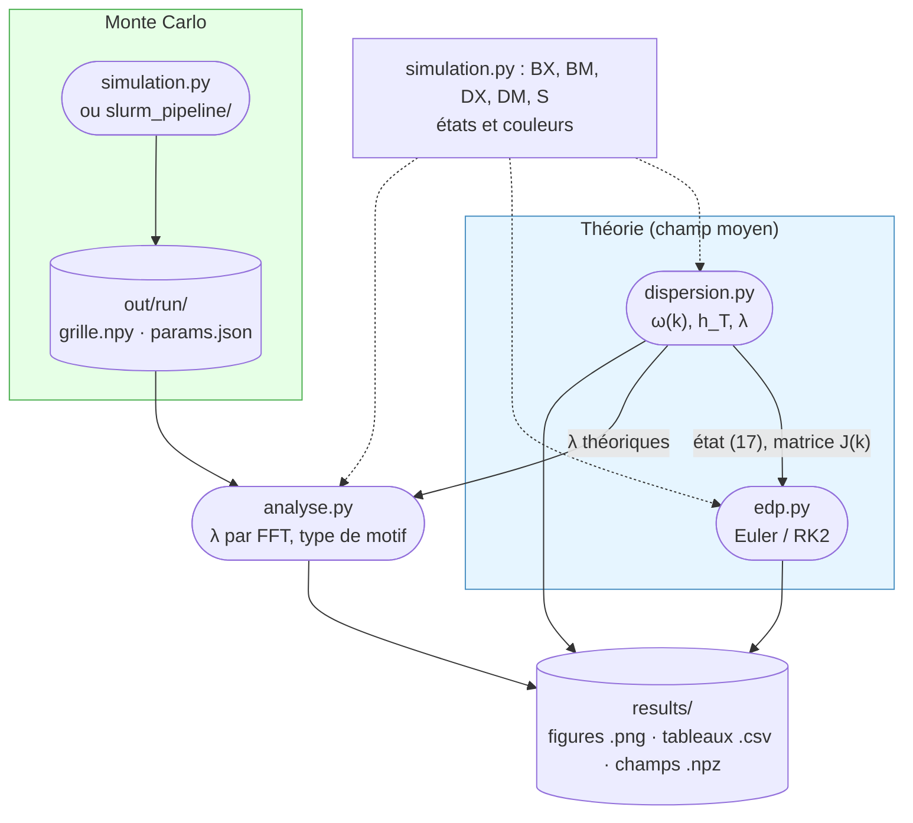
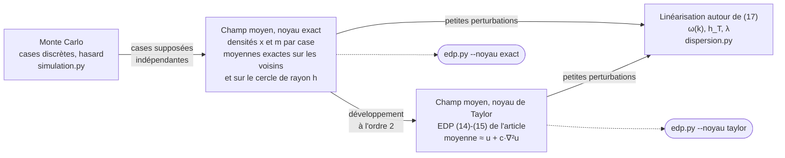
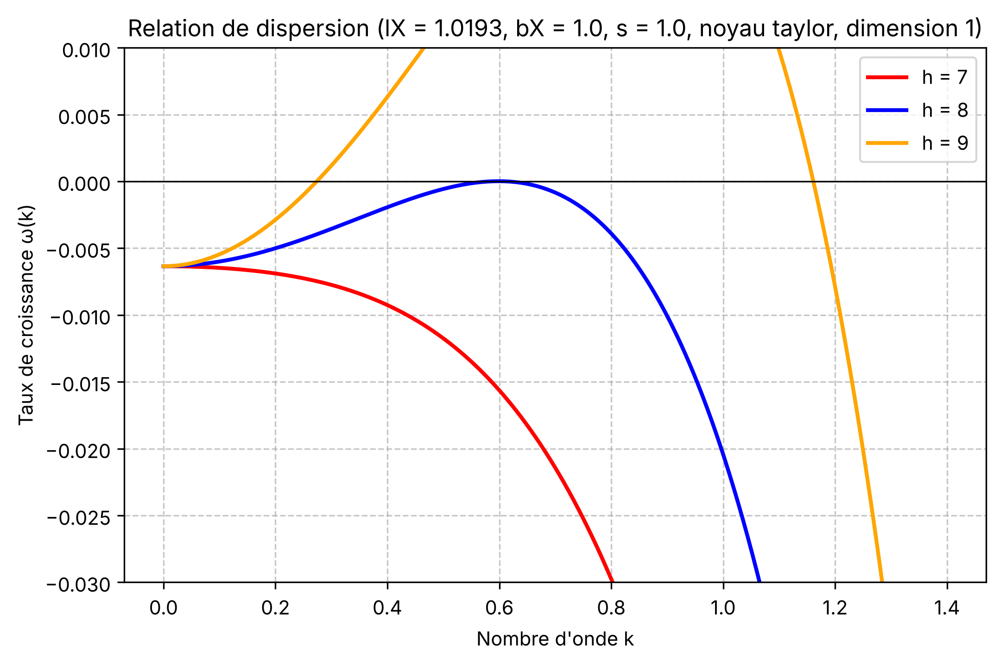
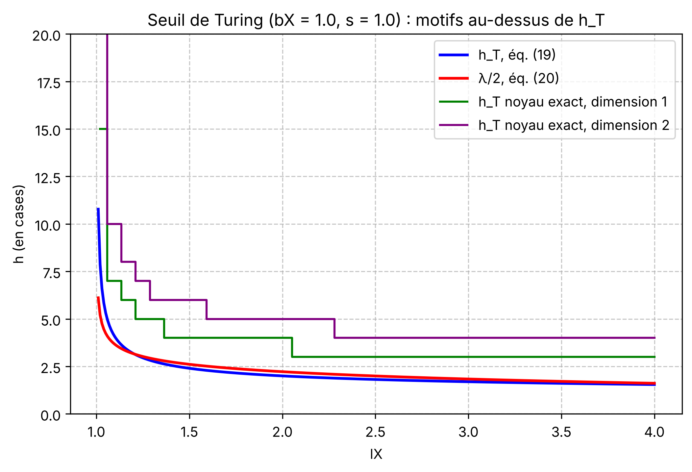
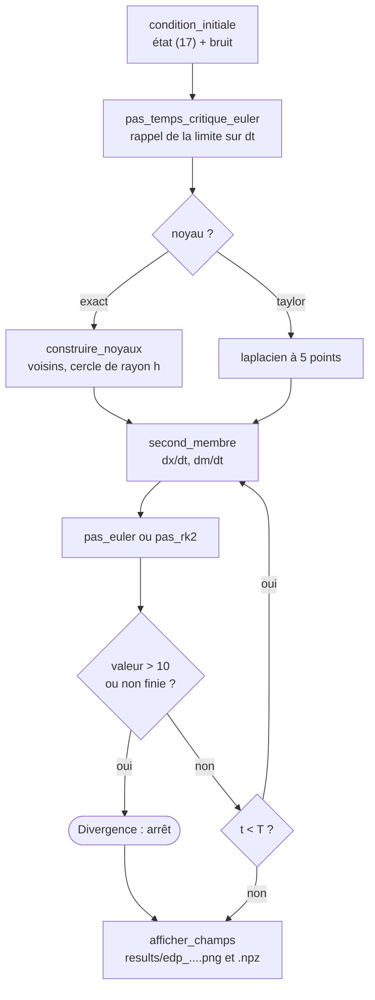
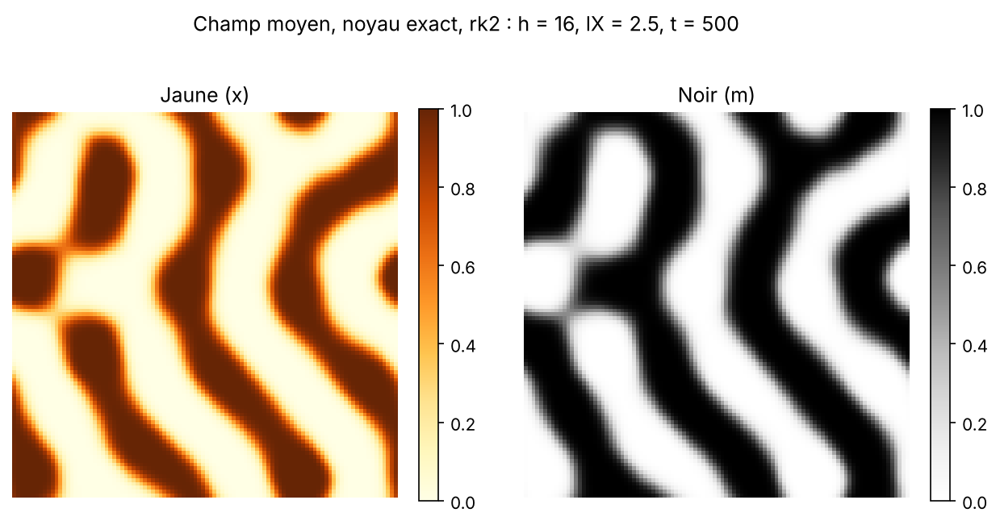
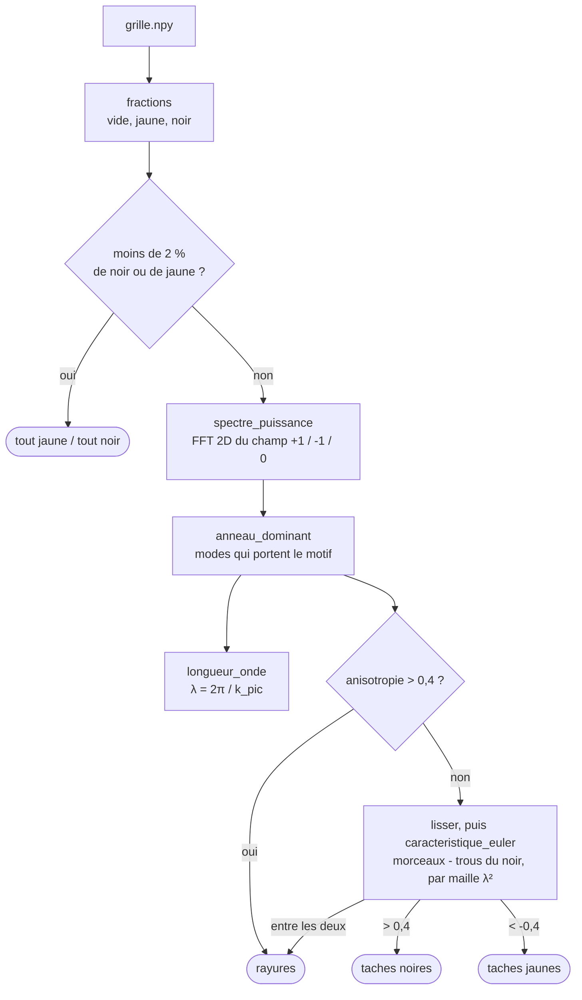
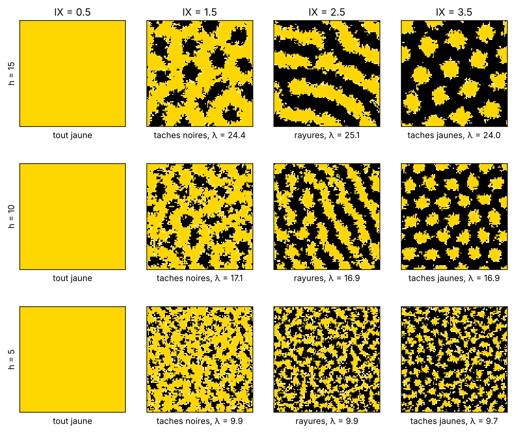
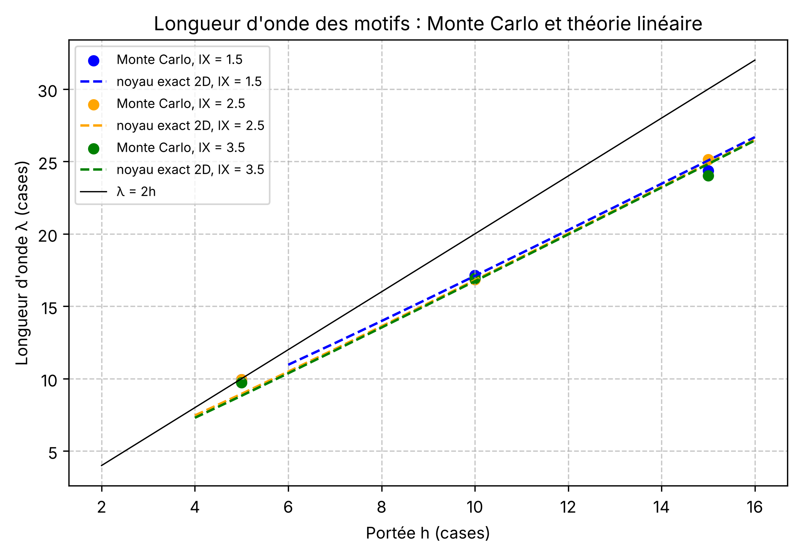

# Théorie et analyse — `dispersion.py`, `edp.py`, `analyse.py`

Ces trois scripts complètent la simulation Monte Carlo (`simulation.py`) : ils correspondent aux pistes (A), (C) et (D) de [projet.md](../projet.md). Ils sont indépendants de Slurm et se lancent en local, depuis la racine du projet, avec numpy et matplotlib.

| Script | Piste | Ce qu'il fait | Durée |
|---|---|---|---|
| `dispersion.py` | (A) | Stabilité linéaire : relation de dispersion ω(k), seuil h_T (19), longueur d'onde λ (20), noyau de Taylor et noyau exact | ≈ 7 s |
| `edp.py` | (C) | Équations de champ moyen intégrées avec Euler ou RK2 : EDP (14)-(15) de l'article, ou version sans développement de Taylor | ≈ 15 s |
| `analyse.py` | (D) | Mesures sur les grilles Monte Carlo (longueur d'onde par FFT, type de motif) et comparaison avec la théorie | ≈ 3 s |

Tous écrivent leurs figures et tableaux dans `results/`. Les figures de cette page sont dans `doc/figures/` ; elles ont été obtenues avec les commandes indiquées.

## 1. Vue d'ensemble



Les taux du modèle (`BX`, `BM`, `DX`, `DM`, `S`) ne sont définis qu'à un seul endroit, en tête de `simulation.py` : les trois scripts les importent.

## 2. Les trois niveaux de description



Les équations de champ moyen (éq. (9)-(10) de l'article, cases supposées indépendantes) sont :

```
dx/dt = bX·S - dX·x - s·x·<m>_voisins
dm/dt = bM·S - dM·m - s·m·<x>_voisins + lX·S·<x>_distance h          S = 1 - x - m
```

Le noyau « exact » calcule les moyennes `<.>` telles quelles. Le noyau « taylor » les remplace par `u + c·∇²u` (voisins) et `u + c·h²·∇²u` (distance h), avec c = 1/2 en dimension 1 et 1/4 en dimension 2 : on obtient exactement les EDP (14)-(15).

## 3. `dispersion.py` — stabilité linéaire

```bash
python dispersion.py
```

Sorties : `results/dispersion_fig3.png`, `results/dispersion_exact.png`, `results/diagramme_fig2.png`, `results/seuils.csv`.

Une perturbation `exp(ikr + ωt)` autour de l'état mélangé (17) est amplifiée si ω(k) > 0. La moyenne sur les voisins la multiplie par A_n(k), celle à distance h par A_h(k) :

| Noyau | Dimension | A_n | A_h |
|---|---|---|---|
| taylor | 1 | 1 − (ka)²/2 | 1 − (kha)²/2 |
| taylor | 2 | 1 − (ka)²/4 | 1 − (kha)²/4 |
| exact | 1 | cos(ka) | cos(kha) |
| exact | 2 | (1 + cos(ka))/2 | J0(kha) |

et la matrice du système linéarisé est (S2 = 1 − x2 − m2) :

```
J11 = -bX - s·m2              J12 = -bX - s·x2·A_n
J21 = -lX·x2 - s·m2·A_n + lX·S2·A_h
J22 = -(s + lX)·x2
```

Avec le noyau de Taylor en dimension 1, c'est exactement `J0 + q·J1` de projet.md (vérifié numériquement, ainsi que la trace et le déterminant `c0 + c1·q + c2·q²`).

### Relation de dispersion (Fig. 3 de l'article)



lX = 1,0193, bX = s = 1. On retrouve les valeurs de projet.md : ω(0) = −0,0063 pour les trois courbes, maximum nul en k_T = 0,60 pour h = 8, et ω > 0 pour k entre 0,27 et 1,16 pour h = 9.

### Seuils (tableau de `results/seuils.csv`)

| lX | h_T (19) | λ (20) | λ/h_T | h_T exact 1D | λ/h exact 1D | h_T exact 2D | λ/h exact 2D |
|---|---|---|---|---|---|---|---|
| 1,0193 | 8,00 | 10,50 | 1,31 | 15 | 2,51 | 21 | 1,88 |
| 1,5 | 2,40 | 5,22 | 2,17 | 4 | 2,48 | 6 | 1,83 |
| 2,5 | 1,81 | 3,99 | 2,20 | 3 | 2,46 | 4 | 1,86 |
| 3,5 | 1,61 | 3,42 | 2,13 | 3 | 2,36 | 4 | 1,82 |

Les cinq premières colonnes redonnent les tableaux des sections 6 et 7 de projet.md. Les seuils « exact » sont le plus petit h entier pour lequel un mode est amplifié. En dimension 2, le seuil de Taylor est le même qu'en dimension 1 et sa longueur d'onde est divisée par √2.

### Diagramme de phase (Fig. 2 de l'article)



Au-dessus de h_T, un motif apparaît ; en dessous, la peau reste uniforme. Le noyau exact demande une portée h plus grande que la formule (19), surtout en dimension 2.

## 4. `edp.py` — équations de champ moyen

```bash
python edp.py --h 16 --lX 2.5                        # noyau exact, RK2, 2D : un motif se forme
python edp.py --h 16 --lX 2.5 --noyau taylor --T 20  # EDP (14)-(15) : divergence
python edp.py --dim 1 --L 200 --h 9 --lX 1.0193 --noyau taylor --T 300
```

| Option | Défaut | Rôle |
|---|---|---|
| `--L` | 100 | Nombre de cases par côté |
| `--dim` | 2 | Dimension de la grille (1 ou 2) |
| `--h` | 16 | Portée de l'interaction à distance |
| `--lX` | 2.5 | Taux de naissance du noir à distance h (≥ bX) |
| `--noyau` | exact | `exact` ou `taylor` |
| `--methode` | rk2 | `euler` ou `rk2` |
| `--dt` | 0.05 | Pas de temps |
| `--T` | 500 | Temps total |
| `--graine` | 0 | Graine du bruit initial |

Sorties : `results/edp_<noyau>_L{L}_h{h}_lX{lX}.png` (champs à la fin) et `.npz` (51 instantanés de x et m, et leurs instants t). L'état de départ est l'état mélangé (17) plus un bruit d'écart-type 0,001.



### Résultats

**Noyau exact** (L = 100, h = 16, lX = 2,5, T = 500) : les densités restent entre 0 et 1 et un motif de rayures en labyrinthe se stabilise.



Sa longueur d'onde, mesurée avec `analyse.py`, est de 26,9 cases : la théorie linéaire en prévoit 26,5 et le Monte Carlo en donne 27,4 pour les mêmes paramètres.

**Noyau de Taylor** (mêmes paramètres) : `Divergence à t = 0.40 : intégration arrêtée`. Les EDP (14)-(15) ne sont valables que pour de petites perturbations : au-delà du seuil, les modes les plus fins de la grille sont amplifiés très vite et rien ne maintient les densités entre 0 et 1. Près du seuil (dimension 1, lX = 1,0193, h = 9), la phase linéaire dure jusqu'à t ≈ 100, puis m devient négatif et la solution diverge aussi. L'article n'utilise d'ailleurs ces EDP que pour l'analyse linéaire.

### Vérifications

Taux de croissance d'un seul mode, mesuré avec `edp.py` (RK2, dt = 0,01) et prévu par `dispersion.py` :

| Dimension | Noyau | lX | h | k | ω mesuré | ω théorique |
|---|---|---|---|---|---|---|
| 1 | taylor | 1,0193 | 9 | 0,628 | +0,01849 | +0,01849 |
| 1 | taylor | 1,0193 | 7 | 0,628 | −0,01652 | −0,01652 |
| 1 | exact | 1,5 | 6 | 0,419 | +0,05590 | +0,05590 |
| 1 | exact | 2,5 | 5 | 0,524 | +0,11740 | +0,11740 |
| 2 | taylor | 1,0193 | 9 | 0,838 | +0,01624 | +0,01624 |
| 2 | exact | 2,5 | 16 | 0,209 | +0,06864 | +0,06888 |
| 2 | exact | 2,5 | 16 | 0,262 | +0,07014 | +0,07099 |

Pour le noyau de Taylor, la théorie est évaluée avec le laplacien discret (k² remplacé par 2(1 − cos k)). L'écart d'environ 1 % en dimension 2 avec le noyau exact vient du cercle de rayon h, arrondi sur la grille dans `edp.py` comme dans le Monte Carlo, alors que `dispersion.py` utilise un cercle parfait (J0).

**Stabilité d'Euler.** `pas_temps_critique_euler` donne le plus grand dt stable. Sur un état stable (sous le seuil), Euler avec 0,9 fois ce dt amortit le bruit, et avec 1,1 fois ce dt il l'amplifie, dans les quatre cas testés (dt critique entre 0,67 et 0,77). Sur cette grille, le mode limitant a une valeur propre réelle (ω ≈ −3) : RK2 a alors la même limite qu'Euler. Il ne serait plus tolérant que pour des modes oscillants ; son intérêt ici est sa précision.

## 5. `analyse.py` — motifs Monte Carlo

```bash
python analyse.py                      # lit out/, écrit dans results/
python analyse.py --out-dir out --dossier-resultats results
```

Sorties : `results/analyse.csv`, `results/analyse_motifs.png`, `results/analyse_lambda.png`.

Pour chaque run de `out/` (grille finale) :



- **Longueur d'onde.** Le spectre de puissance est moyenné par anneaux de même |k| ; λ = 2π/k_pic, où k_pic est la moyenne de |k| pondérée par la puissance sur l'anneau le plus puissant et ses deux voisins.
- **Type de motif.** Des rayures parallèles concentrent le spectre dans une direction (anisotropie proche de 1). Sinon, on compte les morceaux de noir moins ses trous (caractéristique d'Euler) par maille du motif : des taches noires isolées donnent un nombre positif (0,87 pour un réseau hexagonal parfait), un fond noir troué de taches jaunes un nombre négatif, un labyrinthe un nombre proche de 0. C'est un classement automatique simple : un motif intermédiaire peut tomber d'un côté ou de l'autre.
- **Théorie.** `lambda_taylor_20` est l'éq. (20), valable au seuil seulement ; `lambda_exact_1d` et `lambda_exact_2d` sont les longueurs d'onde du mode le plus instable du noyau exact pour le h du run.

### Résultats sur les paramètres de la Fig. 2

12 runs : L = 100, h = 5, 10, 15, lX = 0,5, 1,5, 2,5, 3,5, graine 0, 2·10⁸ pas chacun (t = 20 000, cinq fois moins que les 10⁹ pas de l'article).



On retrouve la séquence de l'article quand lX augmente : tout jaune, taches noires, rayures, taches jaunes ; et la taille du motif augmente avec h.

| h | lX | Motif | λ Monte Carlo | λ/h | λ exact 2D | λ exact 1D | λ (20) |
|---|---|---|---|---|---|---|---|
| 5 | 1,5 | taches noires | 9,93 | 1,99 | — | 11,52 | 5,22 |
| 5 | 2,5 | rayures | 9,94 | 1,99 | 8,95 | 10,86 | 3,99 |
| 5 | 3,5 | taches jaunes | 9,74 | 1,95 | 8,82 | 10,70 | 3,42 |
| 10 | 1,5 | taches noires | 17,13 | 1,71 | 17,10 | 20,76 | 5,22 |
| 10 | 2,5 | rayures | 16,85 | 1,69 | 16,80 | 20,44 | 3,99 |
| 10 | 3,5 | taches jaunes | 16,93 | 1,69 | 16,73 | 20,36 | 3,42 |
| 15 | 1,5 | taches noires | 24,37 | 1,62 | 25,07 | 30,51 | 5,22 |
| 15 | 2,5 | rayures | 25,13 | 1,68 | 24,87 | 30,30 | 3,99 |
| 15 | 3,5 | taches jaunes | 24,03 | 1,60 | 24,83 | 30,24 | 3,42 |

(Les trois runs à lX = 0,5 sont « tout jaune », sans longueur d'onde.)



- Pour h = 10 et 15, la longueur d'onde mesurée est à moins de 4 % de celle du mode le plus instable du noyau exact en dimension 2 : λ ≈ 1,7 h, plutôt que λ ≈ 2h.
- Pour h = 5, le Monte Carlo donne λ ≈ 2h, environ 10 % au-dessus de la théorie. Pour lX = 1,5 et h = 5, le champ moyen ne prévoit aucun motif (seuil exact 2D : h_T = 6), alors que le Monte Carlo en montre un : à petite portée, les corrélations entre cases négligées par le champ moyen comptent.
- La formule (20) ne dépend pas de h : elle ne vaut qu'au seuil et ne décrit pas ces motifs, obtenus loin du seuil.

Ces mesures portent sur une seule graine par configuration et sur des grilles 100 × 100 : la longueur d'onde y est quantifiée (un motif doit tenir un nombre entier de fois dans la boîte), surtout pour h = 15.

## 6. Exemple complet

```bash
# 1. Théorie : figures 2 et 3 de l'article, tableau des seuils
python dispersion.py

# 2. Champ moyen : motif avec le noyau exact, divergence avec les EDP (14)-(15)
python edp.py --h 16 --lX 2.5
python edp.py --h 16 --lX 2.5 --noyau taylor --T 20

# 3. Monte Carlo : les 12 configurations de la Fig. 2 (3 à 4 min chacune en local)
for h in 5 10 15; do
    for lX in 0.5 1.5 2.5 3.5; do
        python simulation.py --L 100 --h $h --lX $lX --n_pas 200000000
    done
done
# ou sur GenOuest :
#   bash slurm_pipeline/01_prepare_chunks.sh --L 100 --h-start 5 --h-end 15 --h-step 5 \
#       --lx-start 0.5 --lx-end 3.5 --lx-step 1 --graines 1 --n-pas 200000000
#   bash slurm_pipeline/03_submit_all.sh

# 4. Analyse des motifs et comparaison avec la théorie
python analyse.py
```

Sortie de l'étape 4 :

```
12 run(s) trouvé(s) dans out
h =   5  lX =  0.5  graine = 0  tout jaune     λ =    nan  (exact 2D : nan)
h =   5  lX =  1.5  graine = 0  taches noires  λ =   9.93  (exact 2D : nan)
h =   5  lX =  2.5  graine = 0  rayures        λ =   9.94  (exact 2D : 8.95)
h =   5  lX =  3.5  graine = 0  taches jaunes  λ =   9.74  (exact 2D : 8.82)
h =  10  lX =  0.5  graine = 0  tout jaune     λ =    nan  (exact 2D : nan)
h =  10  lX =  1.5  graine = 0  taches noires  λ =  17.13  (exact 2D : 17.1)
h =  10  lX =  2.5  graine = 0  rayures        λ =  16.85  (exact 2D : 16.8)
h =  10  lX =  3.5  graine = 0  taches jaunes  λ =  16.93  (exact 2D : 16.73)
h =  15  lX =  0.5  graine = 0  tout jaune     λ =    nan  (exact 2D : nan)
h =  15  lX =  1.5  graine = 0  taches noires  λ =  24.37  (exact 2D : 25.07)
h =  15  lX =  2.5  graine = 0  rayures        λ =  25.13  (exact 2D : 24.87)
h =  15  lX =  3.5  graine = 0  taches jaunes  λ =  24.03  (exact 2D : 24.83)
Tableau sauvegardé dans : results/analyse.csv
Graphique sauvegardé avec succès dans : results/analyse_motifs.png
Graphique sauvegardé avec succès dans : results/analyse_lambda.png
```

## 7. Limites

- **Champ moyen.** `dispersion.py` et `edp.py` supposent les cases indépendantes : pas de bruit, pas de corrélations. L'accord avec le Monte Carlo est bon pour h ≥ 10, moins bon à petite portée.
- **Limite de l'article.** La théorie linéaire est écrite pour bM = dX = dM = 0 et sX = sM = s, autour de l'état (17) : il faut lX ≥ bX. `edp.py` utilise les taux de `simulation.py`, mais son état de départ et son pas de temps critique reposent sur cette limite.
- **Dimension 2.** Le nombre d'onde est pris le long d'un axe de la grille, et `dispersion.py` néglige l'arrondi du cercle de rayon h sur la grille.
- **Iridophores.** Ni la théorie ni `edp.py` ne prennent en compte la bande d'iridophores ; `analyse.py` mesure les runs avec bande mais ne les affiche pas sur la planche des motifs.
- **Classement des motifs.** Les seuils (2 % pour une couleur absente, 0,4 pour l'anisotropie et pour la caractéristique d'Euler) ont été choisis sur les 12 runs ci-dessus.
