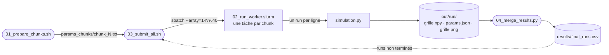

# Pipeline Slurm — BIO-DYN-projet

Architecture Scatter-Gather pour lancer les simulations Monte Carlo sur le cluster Genouest, en balayant les paramètres **h**, **lX** et la largeur de la **bande d'iridophores** (et plusieurs graines), avec éventuellement des options du modèle communes à tous les runs (`--extra`). Sans option, le balayage est exactement celui de la Fig. 2 de l'article. `05_tests_extensions.sh` teste les extensions du modèle aux mêmes points.

## Prérequis

- Accès au cluster avec Slurm
- Environnement conda `biodyn` accessible via `/local/env/envconda.sh` (création une seule fois : `conda create -n biodyn python numpy matplotlib`)
- Se placer à la **racine du projet** pour toutes les commandes

## Vue d'ensemble



## Documentation

| Fichier | Contenu |
|---|---|
| [doc/exemple.md](doc/exemple.md) | **Exemple complet** sur GenOuest : reproduire la Fig. 2, de la connexion au CSV final, relance et variante avec iridophores |
| [doc/architecture.md](doc/architecture.md) | Composants et fichiers, découpage TASK_ID → chunk, déroulé d'un run, iridophores |
| [doc/sequences.md](doc/sequences.md) | Diagrammes de séquence : flux complet, reprise après la limite de temps, états d'un run |
| [doc/tests_extensions.md](doc/tests_extensions.md) | Tests des extensions : variantes, valeurs choisies et pourquoi |

## Utilisation

### Étape 1 — Générer les runs et les découper en chunks

```bash
# Défauts = Fig. 2 de l'article : L=100, h = 5, 10, 15, lX = 0.5, 1.5, 2.5, 3.5, pas d'iridophores, 1 graine, 10⁹ pas
bash slurm_pipeline/01_prepare_chunks.sh

# Plages personnalisées (début / fin / pas)
bash slurm_pipeline/01_prepare_chunks.sh --h-start 4 --h-end 16 --h-step 4 \
    --lx-start 1.5 --lx-end 3.5 --lx-step 1 --graines 1

# Fig. 1a : un seul run
bash slurm_pipeline/01_prepare_chunks.sh --h-start 16 --h-end 16 --lx-start 2.5 --lx-end 2.5

# Fig. 1b–c : iridophores, bandes de 1 et 10 lignes
bash slurm_pipeline/01_prepare_chunks.sh --h-start 16 --h-end 16 \
    --lx-start 2.5 --lx-end 2.5 --bande-start 1 --bande-end 10 --bande-step 9

# Options du modèle pour tous les runs (voir le README du projet)
bash slurm_pipeline/01_prepare_chunks.sh --extra "--reseau hex"
```

Crée `params_chunks/chunk_1.txt`, `chunk_2.txt`, … : une ligne `L h lX bande graine n_pas [options]` par run.
La taille des chunks est configurable via `CHUNK_SIZE=10` en tête du script.

**Options :**

| Option | Défaut | Description |
|--------|--------|-------------|
| `--L` | `100` | Taille de la grille. |
| `--h-start` | `5` | Première valeur de h. |
| `--h-end` | `15` | Dernière valeur de h, incluse. |
| `--h-step` | `5` | Pas du balayage de h. |
| `--lx-start` | `0.5` | Première valeur de lX. |
| `--lx-end` | `3.5` | Dernière valeur de lX, incluse. |
| `--lx-step` | `1` | Pas du balayage de lX. |
| `--bande-start` | `0` | Première largeur de bande d'iridophores, en lignes (0 = pas d'iridophores). |
| `--bande-end` | `0` | Dernière largeur, incluse. |
| `--bande-step` | `1` | Pas du balayage de la bande. |
| `--graines` | `1` | Nombre de répétitions (graines 0 à N-1). |
| `--n-pas` | `1000000000` | Nombre de pas par run, quel que soit L (10⁹, comme l'article). |
| `--extra` | aucune | Options de `simulation.py` pour tous les runs, entre guillemets. |

### Étape 2 — Soumettre les jobs

```bash
bash slurm_pipeline/03_submit_all.sh                 # sans historique
bash slurm_pipeline/03_submit_all.sh --historique    # garde une grille à chaque sauvegarde
```

Soumet **un seul Job Array CPU**, une tâche par chunk. Avec `--historique`, chaque run garde une copie de la grille à chaque sauvegarde (tous les `PAS_ENTRE_SAUVEGARDES` pas), et une tous les `PAS_ENTRE_GRILLES` pas pendant `PAS_RECONSTRUCTION` pas au départ et après chaque blessure, dans `out/<run>/historique/`, pour en faire un GIF ou une timeline avec `timeline.py`. Surveiller l'avancement :

```bash
squeue -u $USER
```

**Relancer** : refaire la même commande (avec `--historique` s'il était là). Les runs terminés sont sautés, les runs interrompus (limite de 24 h, nœud perdu) reprennent depuis leur dernière sauvegarde.

### Étape 3 — Récupérer les paramètres des runs

```bash
python slurm_pipeline/04_merge_results.py
# options : --out-dir DOSSIER  --output CSV
```

Produit `results/final_runs.csv` : une ligne par run (`L, h, lX, bande, graine`, les options du modèle, puis `n_pas, pas_faits, t, termine, dossier`). Les runs avec `termine = False` sont à relancer (étape 2).

### Tests des extensions

```bash
bash slurm_pipeline/05_tests_extensions.sh
```

Lance 5 variantes (réseau hexagonal, contact, blessures au hasard avec ou sans contact, blessure unique) aux 12 points de la Fig. 2, soit 60 runs avec historique, puis `06_timelines.slurm` fait le GIF et la frise de chaque run quand toutes les tâches sont finies. Valeurs et raisons : [doc/tests_extensions.md](doc/tests_extensions.md).

---

## Architecture des scripts

| Fichier | Rôle |
|---------|------|
| `01_prepare_chunks.sh` | Génère les runs des plages et les chunks (`params_chunks/`) |
| `02_run_worker.slurm` | Worker exécuté par chaque tâche Slurm : lance les runs de son chunk |
| `03_submit_all.sh` | Soumission du Job Array (et relance) |
| `04_merge_results.py` | Récupère les paramètres et l'état de tous les runs dans un CSV |
| `05_tests_extensions.sh` | Tests des extensions : chunks dans `params_chunks_tests/`, Job Array, puis GIF |
| `06_timelines.slurm` | GIF et frise (`timeline.py`) de chaque run avec historique |

## Paramètres configurables

| Fichier | Variable | Défaut | Description |
|---------|----------|--------|-------------|
| `01_prepare_chunks.sh` | `CHUNK_SIZE` | `10` | Runs par chunk |
| `01_prepare_chunks.sh` | `DEFAULT_*` | voir options | Plages par défaut |
| `03_submit_all.sh` | `MAX_CONCURRENT_CPU` | `40` | Tâches simultanées |
| `05_tests_extensions.sh` | `VARIANTES`, `LB` | voir le script | Variantes testées et taux de blessure |

## Structure des sorties

```
params_chunks/
├── chunk_1.txt                            # une ligne "L h lX bande graine n_pas [options]" par run
└── ...
params_chunks_tests/                       # idem pour 05_tests_extensions.sh

out/
├── L100_h5_lX0.5_b0_g0/                   # un dossier par run (simulation.py)
│   ├── grille.npy
│   ├── params.json
│   ├── grille.png
│   ├── historique/                        # avec --historique : grille_<pas>.npz
│   └── timeline.gif, timeline.png         # GIF et frise (timeline.py, 06_timelines.slurm)
└── L100_h5_lX0.5_b0_g0_hex/               # même run avec --extra "--reseau hex"

results/
└── final_runs.csv                         # paramètres et état de tous les runs (étape 3)

logs/
├── slurm_<JOB_ID>_<TASK_ID>.out          # Logs Slurm par tâche
└── slurm_gif_<JOB_ID>.out                # Log de 06_timelines.slurm
```

Détails : iridophores et découpage TASK_ID → chunk dans [doc/architecture.md](doc/architecture.md).
