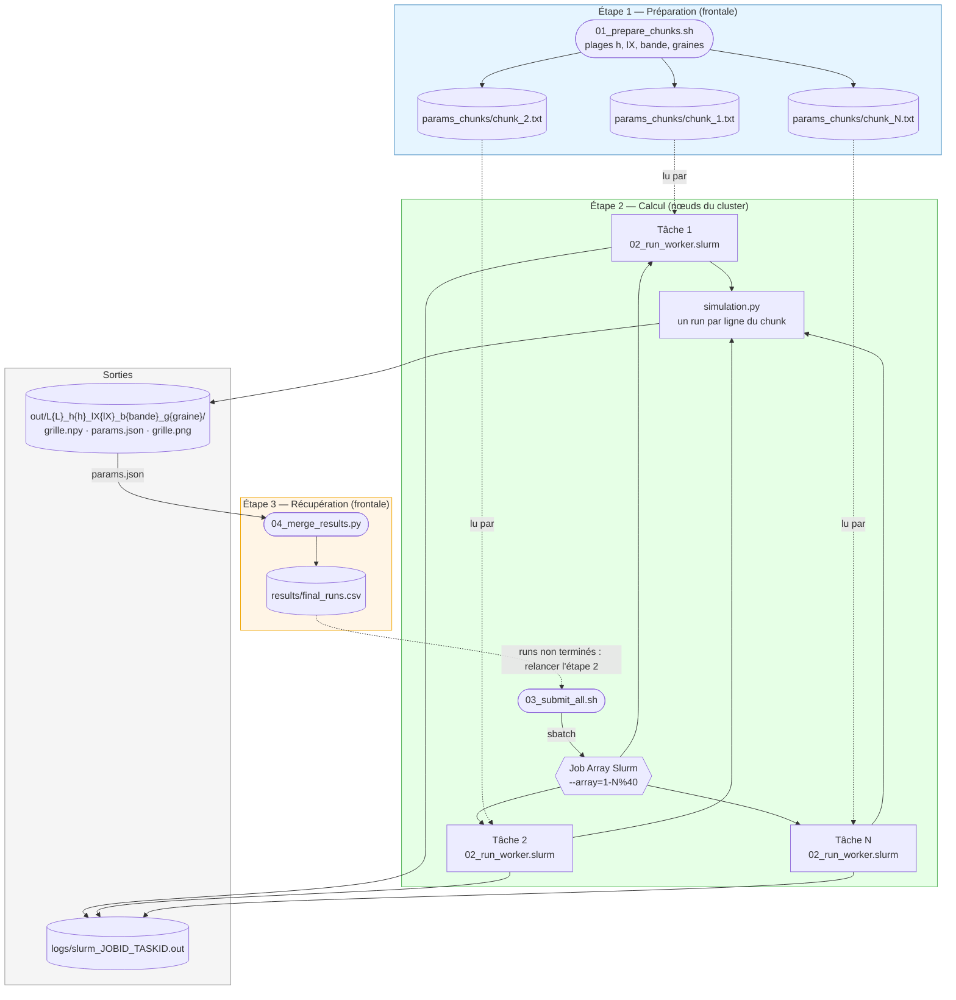
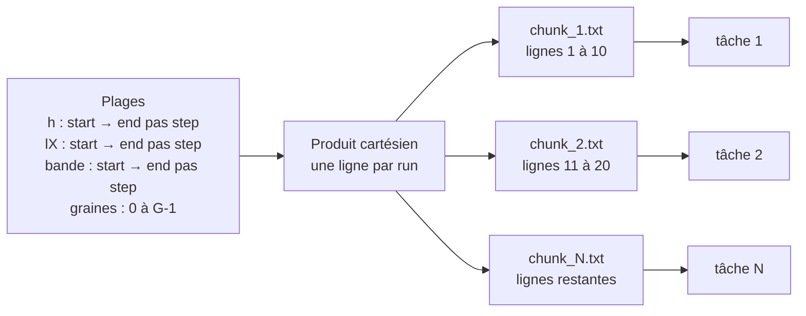
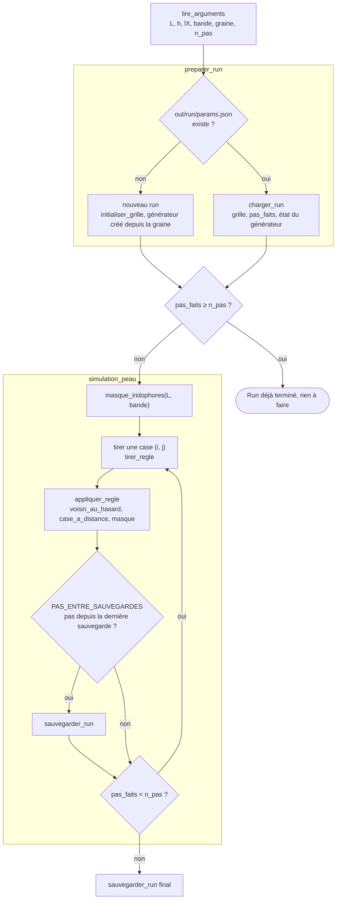
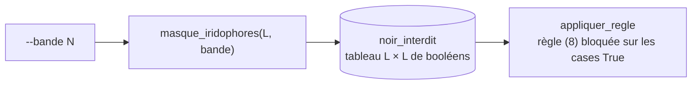

# Architecture — pipeline Slurm

Composants du pipeline, fichiers qu'ils lisent et écrivent, et découpage du travail en tâches.

## 1. Vue d'ensemble



| Fichier | Où il tourne | Rôle |
|---|---|---|
| `01_prepare_chunks.sh` | frontale | Génère une ligne `L h lX bande graine n_pas` par run et les répartit en chunks de `CHUNK_SIZE` lignes |
| `03_submit_all.sh` | frontale | Compte les chunks et soumet un seul Job Array, une tâche par chunk |
| `02_run_worker.slurm` | nœud de calcul | Lance l'un après l'autre les runs de son chunk |
| `simulation.py` | nœud de calcul | Un run : simulation, sauvegarde régulière, reprise |
| `04_merge_results.py` | frontale | Rassemble les `params.json` de tous les runs dans un CSV |

## 2. Découpage en tâches : TASK_ID → chunk

Toutes les combinaisons des plages sont écrites, une par ligne, puis découpées en paquets de `CHUNK_SIZE` lignes (10 par défaut). La tâche `N` du Job Array traite `params_chunks/chunk_N.txt` :

```
CHUNK_ID = TASK_ID
nombre de tâches = ⌈ nombre de runs / CHUNK_SIZE ⌉
```



Ordre des lignes : h varie le plus lentement, puis lX, puis bande, puis la graine. Avec les valeurs par défaut (19 h × 30 lX × 1 bande × 3 graines = 1710 runs), on obtient 171 chunks, soit `--array=1-171%40` : bien en dessous de la limite de taille des Job Arrays.

## 3. Un run : `simulation.py`

`simulation.py` ne connaît pas Slurm : il reçoit les paramètres d'un run en ligne de commande, ce qui permet aussi de le lancer à la main en local.



## 4. Iridophores

Les iridophores ne sont pas simulés comme des cellules : ils sont représentés par un masque de cases où le noir ne peut pas naître (`masque_iridophores` dans `simulation.py`). La règle (8) y est bloquée, ainsi que la règle (3) si bM devenait non nul.



Aujourd'hui le masque est une bande horizontale de `bande` lignes au milieu de la grille (Fig. 1b–c), 0 = pas d'iridophores. Pour une autre forme, seule `masque_iridophores` est à modifier : le reste du code ne lit que le masque.

## Principes clés

- **Une tâche = un chunk**, comme dans le pipeline de BenchQBR : le nombre de tâches reste faible même pour de gros balayages, et `MAX_CONCURRENT_CPU` limite le nombre de tâches simultanées.
- **Un run = un dossier** `out/L{L}_h{h}_lX{lX}_b{bande}_g{graine}/`. Son nom ne dépend pas de `n_pas` : relancer avec un `n_pas` plus grand prolonge le run au lieu d'en créer un nouveau.
- **Reprise automatique** : le run est sauvegardé tous les `PAS_ENTRE_SAUVEGARDES` pas, avec l'état du générateur aléatoire. Relancer `03_submit_all.sh` reprend les runs interrompus au dernier point sauvegardé et saute les runs terminés.
- **Chemins relatifs à la racine du projet** : `03_submit_all.sh` passe `--chdir` à Slurm, les tâches écrivent donc toujours dans `out/` et `logs/` à la racine.
- **Ne pas relancer `01_prepare_chunks.sh` tant que des tâches sont en attente** : il efface et réécrit `params_chunks/`, et chaque tâche ne lit son chunk qu'au moment où elle démarre.
