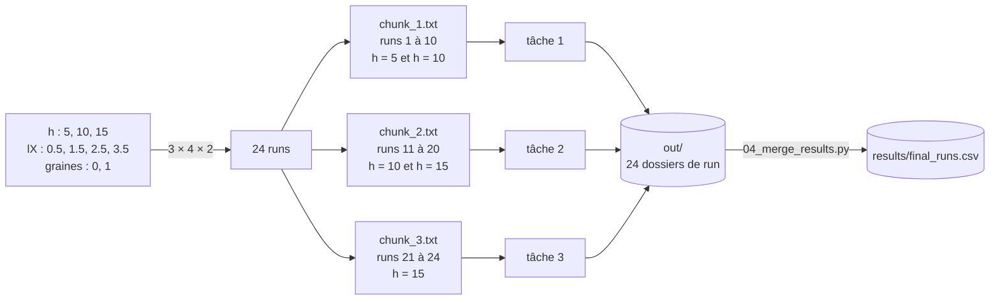

# Exemple complet — reproduire la Fig. 2 sur GenOuest

Objectif : lancer les simulations de la Fig. 2 de l'article, de la connexion au cluster jusqu'au tableau final des runs.

| Paramètre | Valeurs | Option de `01_prepare_chunks.sh` |
|---|---|---|
| L | 100 | `--L 100` |
| h | 5, 10, 15 | `--h-start 5 --h-end 15 --h-step 5` |
| lX | 0.5, 1.5, 2.5, 3.5 | `--lx-start 0.5 --lx-end 3.5 --lx-step 1` |
| bande | 0 (pas d'iridophores) | défaut |
| graines | 0, 1 | `--graines 2` |
| n_pas | 100000 × L² = 10⁹ | défaut |

Soit 3 × 4 × 1 × 2 = **24 runs**, répartis en **3 chunks**, donc **3 tâches Slurm**.



> Les fonctions de `simulation.py` et `04_merge_results.py` ne sont pas encore implémentées. Les sorties des scripts Slurm (étapes 1 et 2) ci-dessous sont celles qu'ils produisent réellement ; celles des runs (journaux de `simulation.py`, `params.json`, `final_runs.csv`) montrent le format attendu une fois le code écrit. Les numéros de job et le login sont des exemples.

## 0. Se connecter et récupérer le projet

```bash
ssh <login>@genossh.genouest.org
cd /scratch/<login>
git clone https://github.com/Spc-Marcus/BIO-DYN-projet.git
cd BIO-DYN-projet
git checkout base-dev        # tant que la branche n'est pas fusionnée dans main
```

Toutes les commandes suivantes se lancent depuis la racine `BIO-DYN-projet/`.

## 1. Créer l'environnement conda (une seule fois)

```bash
. /local/env/envconda.sh
conda create -n biodyn python numpy matplotlib
```

`02_run_worker.slurm` active cet environnement sur chaque nœud.

## 2. Étape 1 — Générer les runs et les chunks

```bash
bash slurm_pipeline/01_prepare_chunks.sh --L 100 \
    --h-start 5 --h-end 15 --h-step 5 \
    --lx-start 0.5 --lx-end 3.5 --lx-step 1 \
    --graines 2
```

Sortie :

```
[LOG: Nettoyage] Suppression de /scratch/<login>/BIO-DYN-projet/params_chunks
[LOG: Préparation] L=100 h=[5..15/5] lX=[0.5..3.5/1] bande=[0..0/1] graines=2 n_pas=1000000000
[LOG: Préparation] 24 run(s) → 3 chunk(s) de 10 max
[LOG: Chunk 1] 10 run(s) → /scratch/<login>/BIO-DYN-projet/params_chunks/chunk_1.txt
[LOG: Chunk 2] 10 run(s) → /scratch/<login>/BIO-DYN-projet/params_chunks/chunk_2.txt
[LOG: Chunk 3] 4 run(s) → /scratch/<login>/BIO-DYN-projet/params_chunks/chunk_3.txt
[LOG: Terminé] 3 chunk(s) créé(s) dans /scratch/<login>/BIO-DYN-projet/params_chunks
Utilisez --array=1-3 dans vos jobs Slurm.
3
```

Contenu de `params_chunks/chunk_1.txt`, une ligne `L h lX bande graine n_pas` par run :

```
100 5 0.5 0 0 1000000000
100 5 0.5 0 1 1000000000
100 5 1.5 0 0 1000000000
100 5 1.5 0 1 1000000000
100 5 2.5 0 0 1000000000
100 5 2.5 0 1 1000000000
100 5 3.5 0 0 1000000000
100 5 3.5 0 1 1000000000
100 10 0.5 0 0 1000000000
100 10 0.5 0 1 1000000000
```

Et `params_chunks/chunk_3.txt`, le dernier chunk, incomplet :

```
100 15 2.5 0 0 1000000000
100 15 2.5 0 1 1000000000
100 15 3.5 0 0 1000000000
100 15 3.5 0 1 1000000000
```

## 3. Étape 2 — Soumettre le Job Array

```bash
bash slurm_pipeline/03_submit_all.sh
```

Sortie :

```
[LOG: Config] 3 chunk(s) dans /scratch/<login>/BIO-DYN-projet/params_chunks
[LOG: Soumis] Pool CPU — 3 tâches → Submitted batch job 123456
[LOG: Terminé] Job soumis. Utilisez 'squeue -u $USER' pour suivre l'avancement.
```

Suivre les tâches (`R` = en cours, `PD` = en attente) :

```bash
squeue -u $USER
```

```
   JOBID   PARTITION      NAME   USER ST   TIME  NODES NODELIST(REASON)
123456_1    genouest biodyn_c  login  R   0:42      1 node01
123456_2    genouest biodyn_c  login  R   0:42      1 node02
123456_3    genouest biodyn_c  login  R   0:42      1 node03
```

Chaque tâche écrit son journal dans `logs/slurm_<JOBID>_<TASKID>.out`. Par exemple `logs/slurm_123456_3.out`, une fois la tâche 3 terminée :

```
[LOG: Démarrage] Job=123459 Tâche=3 chunk=3 cwd=/scratch/<login>/BIO-DYN-projet
[LOG: Run] L=100 h=15 lX=2.5 bande=0 graine=0 n_pas=1000000000
Run out/L100_h15_lX2.5_b0_g0 : 0 / 1000000000 pas déjà faits
Run terminé, résultats dans out/L100_h15_lX2.5_b0_g0
[LOG: Run] L=100 h=15 lX=2.5 bande=0 graine=1 n_pas=1000000000
Run out/L100_h15_lX2.5_b0_g1 : 0 / 1000000000 pas déjà faits
Run terminé, résultats dans out/L100_h15_lX2.5_b0_g1
[LOG: Run] L=100 h=15 lX=3.5 bande=0 graine=0 n_pas=1000000000
Run out/L100_h15_lX3.5_b0_g0 : 0 / 1000000000 pas déjà faits
Run terminé, résultats dans out/L100_h15_lX3.5_b0_g0
[LOG: Run] L=100 h=15 lX=3.5 bande=0 graine=1 n_pas=1000000000
Run out/L100_h15_lX3.5_b0_g1 : 0 / 1000000000 pas déjà faits
Run terminé, résultats dans out/L100_h15_lX3.5_b0_g1
[LOG: Fin] Tâche=3 chunk=3 code_sortie=0
```

(Slurm donne à chaque tâche d'un Job Array son propre numéro de job : ici 123459 pour la tâche 3 du job 123456.)

## 4. Ce qu'écrit un run

```
out/L100_h15_lX2.5_b0_g0/
├── grille.npy      # la grille L × L (0 = vide, 1 = jaune, 2 = noir)
├── params.json     # paramètres et avancement du run
└── grille.png      # image de la grille
```

`params.json` contient les paramètres, `pas_faits`, le temps `t = pas_faits / L²` et l'état du générateur aléatoire. Contenu attendu pour un run terminé :

```json
{
  "L": 100,
  "h": 15,
  "lX": 2.5,
  "bande": 0,
  "graine": 0,
  "n_pas": 1000000000,
  "sortie": "out/L100_h15_lX2.5_b0_g0",
  "pas_faits": 1000000000,
  "t": 100000.0,
  "etat_generateur": { "…": "…" }
}
```

## 5. Relancer après une coupure

Supposons que la tâche 1 atteigne la limite de 24 h pendant son 7ᵉ run (h = 5, lX = 3.5, graine 0). Le run a été sauvegardé régulièrement ; les 6 premiers sont terminés, les runs 8 à 10 n'ont pas commencé.

On relance avec **la même commande**, sans refaire l'étape 1 :

```bash
bash slurm_pipeline/03_submit_all.sh
```

Les tâches 2 et 3 sautent tous leurs runs. Le journal de la nouvelle tâche 1 commence ainsi :

```
[LOG: Démarrage] Job=123470 Tâche=1 chunk=1 cwd=/scratch/<login>/BIO-DYN-projet
[LOG: Run] L=100 h=5 lX=0.5 bande=0 graine=0 n_pas=1000000000
Run out/L100_h5_lX0.5_b0_g0 : 1000000000 / 1000000000 pas déjà faits
Run déjà terminé, rien à faire
…
[LOG: Run] L=100 h=5 lX=3.5 bande=0 graine=0 n_pas=1000000000
Run out/L100_h5_lX3.5_b0_g0 : 420000000 / 1000000000 pas déjà faits
Run terminé, résultats dans out/L100_h5_lX3.5_b0_g0
[LOG: Run] L=100 h=5 lX=3.5 bande=0 graine=1 n_pas=1000000000
Run out/L100_h5_lX3.5_b0_g1 : 0 / 1000000000 pas déjà faits
…
```

Le run 7 reprend à 420 000 000 pas, sa dernière sauvegarde, avec le même état du générateur.

Pour **prolonger** des runs terminés : refaire l'étape 1 avec un `--n-pas` plus grand (mêmes plages), puis l'étape 2. Les dossiers ne dépendent pas de `n_pas`, les runs repartent donc de là où ils s'étaient arrêtés.

## 6. Étape 3 — Récupérer les paramètres de tous les runs

Une fois toutes les tâches terminées (`squeue -u $USER` vide), dans l'environnement conda :

```bash
. /local/env/envconda.sh && conda activate biodyn
python slurm_pipeline/04_merge_results.py
```

`results/final_runs.csv`, une ligne par run, triée par h, lX, bande puis graine (extrait) :

```
L,h,lX,bande,graine,n_pas,pas_faits,t,termine,dossier
100,5,0.5,0,0,1000000000,1000000000,100000.0,True,L100_h5_lX0.5_b0_g0
100,5,0.5,0,1,1000000000,1000000000,100000.0,True,L100_h5_lX0.5_b0_g1
100,5,1.5,0,0,1000000000,1000000000,100000.0,True,L100_h5_lX1.5_b0_g0
…
100,15,3.5,0,1,1000000000,1000000000,100000.0,True,L100_h15_lX3.5_b0_g1
```

Un run avec `termine = False` est à relancer (section 5).

## 7. Rapatrier les résultats sur sa machine

Depuis sa machine :

```bash
scp -r <login>@genossh.genouest.org:/scratch/<login>/BIO-DYN-projet/out ./
scp <login>@genossh.genouest.org:/scratch/<login>/BIO-DYN-projet/results/final_runs.csv ./
```

## 8. Variante — avec iridophores (Fig. 1b–c)

Bandes d'iridophores de 1 et 10 lignes, pour h = 16 et lX = 2.5 :

```bash
bash slurm_pipeline/01_prepare_chunks.sh --L 100 \
    --h-start 16 --h-end 16 \
    --lx-start 2.5 --lx-end 2.5 \
    --bande-start 1 --bande-end 10 --bande-step 9 \
    --graines 1
bash slurm_pipeline/03_submit_all.sh
```

2 runs (`out/L100_h16_lX2.5_b1_g0` et `out/L100_h16_lX2.5_b10_g0`) dans 1 chunk, donc une seule tâche (`--array=1-1%40`).

## Récapitulatif

```bash
. /local/env/envconda.sh && conda create -n biodyn python numpy matplotlib     # une seule fois
bash slurm_pipeline/01_prepare_chunks.sh --L 100 --h-start 5 --h-end 15 --h-step 5 \
    --lx-start 0.5 --lx-end 3.5 --lx-step 1 --graines 2                     # étape 1
bash slurm_pipeline/03_submit_all.sh                                          # étape 2 (et relance)
squeue -u $USER                                                               # suivi
conda activate biodyn && python slurm_pipeline/04_merge_results.py           # étape 3
```
