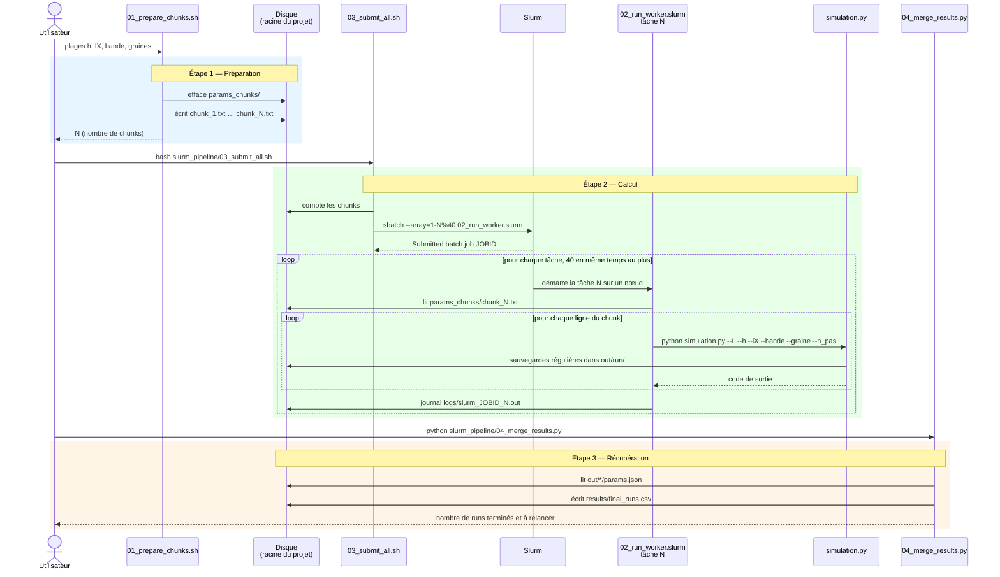
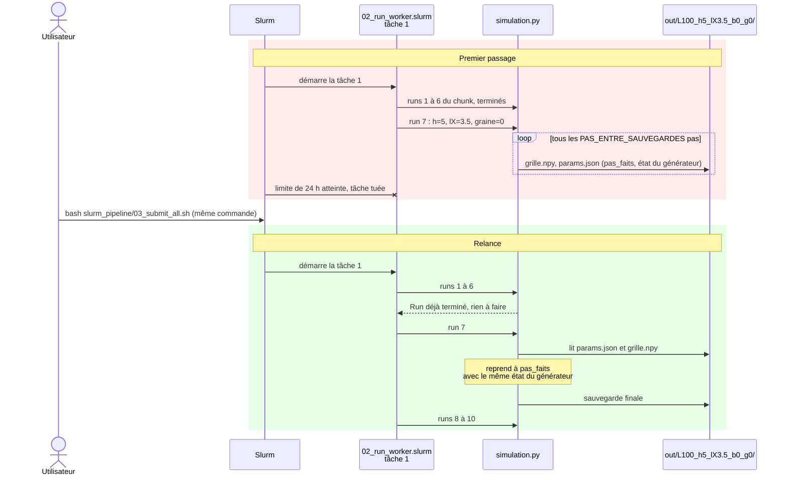
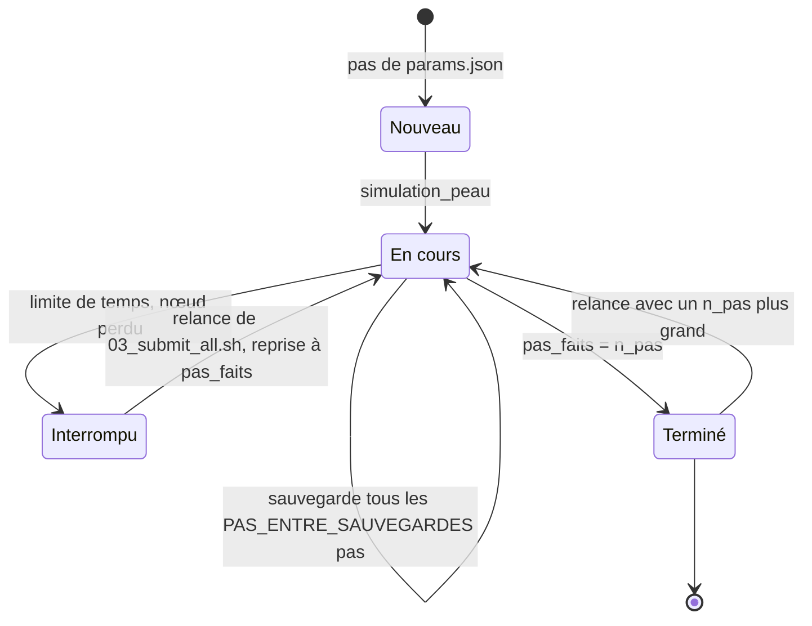

# Diagrammes de séquence — pipeline Slurm

## 1. Flux complet (cas nominal)

```bash
bash slurm_pipeline/01_prepare_chunks.sh --h-start 5 --h-end 15 --h-step 5 --lx-start 0.5 --lx-end 3.5 --lx-step 1
bash slurm_pipeline/03_submit_all.sh
python slurm_pipeline/04_merge_results.py
```



## 2. Reprise après la limite de temps

Une tâche est tuée par Slurm au bout de 24 h (`#SBATCH --time`). On relance avec la **même** commande `03_submit_all.sh`, sans repasser par l'étape 1.



## 3. États d'un run



Dans `results/final_runs.csv` (étape 3), un run **Terminé** a `termine = True` ; un run **Interrompu** a `termine = False` et doit être relancé.
